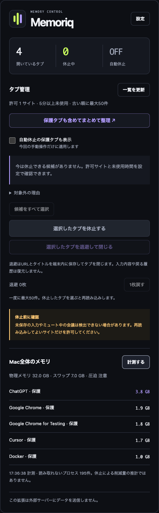

# Memoriq

**Macに、メモリのゆとりを。使用量を見ながら、未使用Chromeタブを休止・退避します。**

## 概要

Memoriqは、メモリの状況を確認するSwift製アプリと、未使用タブを整理するChrome拡張です。タブを残す通常休止と、URLを保存して閉じる退避を選べます。処理はMac内で完結し、アカウントは不要です。自動休止は初期OFFです。

現在はソースからビルドするローカル版です。公証済みアプリやChrome Web Storeへの公開は行っていません。

[セットアップ](#セットアップ) · [削減効果・テスト結果](#削減効果とテスト結果) · [ライセンス・OSS](#ライセンスと利用oss)

| | できること |
|:--|:--|
| **Macを見渡す** | メモリ圧迫・スワップ・アプリ別使用量を30秒ごとに確認。起動時のダッシュボードとメニューバーからアクセスできます。 |
| **Chromeを軽くする** | 最大50枚をまとめて休止。全サイトから今すぐ整理するモードと、未使用時間に応じた自動休止に対応します。 |
| **さらに減らす** | 通常休止で効果が小さい場合は、URLを端末内へ退避してタブを閉じます。必要なページを一覧から復元できます。 |
| **作業を守る** | 選択中・固定・音声再生中などのタブを除外。実行直前にも状態を確認します。 |
| **他のアプリを休ませる** | Electronアプリなどを通常終了し、プロセス終了を確認。休ませたアプリは一覧から再起動できます。 |

<p align="center">
  
</p>
<p align="center"><sub>Chrome拡張の画面。ネイティブアプリとの連携は任意です。</sub></p>

他社製Electronアプリの内部メモリを、動作を保ったまま一律に削減する機能はありません。Memoriqでは、Chromeのタブ解放とMac全体の使用状況の確認を組み合わせます。

## 削減効果とテスト結果

**検証用Chromeでは、6枚のタブを退避して約516 MiB・約45%の減少を2回確認しました。** 普段の業務タブやMac全体で、同じ削減率が出ることを示す結果ではありません。以下は2026年10月28日のローカル開発版での観測です。

### メモリ削減の実測

| 操作・試行 | 測定対象 | 操作前 | 操作後 | 減少量 |
|:--|:--|--:|--:|--:|
| 6枚を退避・初回 | 専用Chrome for Testing全体 | 1,134.7 MiB | 619.0 MiB | **515.8 MiB（45.5%）** |
| 6枚を退避・再試行 | 専用Chrome for Testing全体 | 1,139.4 MiB | 623.6 MiB | **515.8 MiB（45.3%）** |
| テストアプリを通常終了 | 専用Macアプリのプロセス群 | 約274 MiB | プロセス消失 | 約274 MiBの負担が集計から消失 |

退避の試験はChrome for Testing 151の専用プロファイルで行い、6枚それぞれに64 MiBの疑似乱数データを確保しました。別の入力中タブは開いたまま内容を保持し、退避した1枚を一覧から復元して表示できることも確認しています。メモリはOSの`phys_footprint`によるブラウザ全体の負担を前後各5回・500ミリ秒間隔で測り、中央値を比較しました。退避後は10秒待って計測しています。1 MiBは1,048,576バイトです。

Macアプリの試験では、256 MiBを確保する専用アプリを画面操作で通常終了し、再起動後に約274 MiBの負担が戻ることまで確認しました。これは終了による解放の確認です。他社製Electronアプリでの実測ではなく、利用中のユーザーアプリは終了していません。[負荷条件・OSSの取り込み・測定詳細](docs/oss-research.md#検証結果の読み方)

**通常休止の効果にはばらつきがあります。** 旧版0.1を普段のGoogle Chrome 156.0.8078.48へ導入した測定では、閲覧用GitHubタブ1枚の休止前後で、Chrome全体が102.7〜194.2 MiB（4.5〜7.6%、2試行）減少しました。前後各7回の中央値による観測で、他タブなどの変動も含みます。一方、0.2の専用負荷では通常休止後に増加した試行もあり、休止件数だけから削減量は判断できません。[普段のChromeでの測定条件](docs/installed-measurement.md)

> **効果の確認範囲**：上記の差分を足したり、タブ数に比例させたりして削減量を推計することはできません。普段のChromeでの0.2の退避効果は未確認です。旧版の実測でもMac全体のメモリ圧迫は改善したと確認できず、スワップが即座に減るとは限りません。

### テストで確認したこと

| 対象 | 結果 | 主な確認内容 |
|:--|:--|:--|
| Chrome拡張のロジック | **45件成功**・行カバレッジ **94.70%** | タブの保護、入力チェック、保存失敗時に閉じないこと、実行直前の状態変化、復元失敗時の記録保持 |
| Swiftのコア | **16件成功**・行カバレッジ **90.10%** | 実MacのRAM取得、集計、保護、連携プロトコル、終了確認前の休止登録拒否 |
| 実ブラウザ・画面操作 | 成功 | Chrome for Testingで休止・再読込・退避・復元、入力中タブの保持、HTMLバックアップのダウンロード |
| 連携・インストール | 成功 | Native Messagingの往復と不正要求・送信元の拒否、一時フォルダへの導入、既存の別アプリ・別ホストの保持 |

カバレッジはそれぞれ計測した拡張ロジックとSwiftコアの範囲です。全UI・全環境の動作や削減効果を保証する値ではありません。検証環境では普段のChromeにも0.2のファイルを導入済みですが、再読み込みと任意のサイトアクセス許可にはユーザー操作が必要で、0.2の通常プロファイルでの動作確認は未完了です。[検証記録と未確認の範囲](docs/verification.md) · [再現・開発手順](docs/development.md)

## 技術スタック

- macOS 13以降 / Swift 6 / SwiftUI / AppKit
- C（`libproc` によるメモリ・プロセス統計）
- Chrome拡張: Manifest V3 / JavaScript（ES modules）、Chrome 121以降
- Native Messaging（読み取り専用。拡張からの計測要求時のみ）
- Python 3（ビルド・インストール）
- Node.js 20以降（拡張テスト）。実ブラウザでの休止・復帰確認は Node.js 22以降

## セットアップ

**必要な環境:** macOS 13以降、Swift 6対応ツールチェーン、Python 3、Google Chrome 121以降。テストにはNode.js 20以降も使用します。

### 1. Macアプリをインストール

```sh
git clone https://github.com/bassmicrobe/Memoriq.git
cd Memoriq
python3 scripts/build-app.py
python3 scripts/install.py
open "$HOME/Applications/Memoriq.app"
```

`dist/Memoriq.app`をビルドし、`~/Applications/Memoriq.app`へインストールします。Chromeとの読み取り専用連携も登録されます。ビルドは実行したMacのアーキテクチャ用で、ad-hoc署名を使用します。

### 2. Chrome拡張を読み込む

1. Chromeで`chrome://extensions`を開き、**デベロッパー モード**をオンにします。
2. **パッケージ化されていない拡張機能を読み込む**を選びます。
3. 次のフォルダを指定します。ファイル選択画面で`⌘⇧G`を押すと、パスを入力できます。

   ```text
   ~/Applications/Memoriq.app/Contents/Resources/extension
   ```

アプリの**拡張フォルダ**ボタンからFinderに表示することもできます。管理対象Chromeでは、所属組織の拡張機能ポリシーに従ってください。

Chromeで複数のプロファイルを使う場合は、利用するプロファイルごとに拡張を読み込んでください。許可サイトなどの設定もプロファイルごとに保存されます。

## 使い方

拡張の**設定**で、休止してよいホスト名と未使用時間を指定します。まずは自動休止をOFFのまま、**タブ整理へ**から候補を確認し、選択したタブを休止してください。Macの使用量は**計測する**で取得できます。

拡張だけでもタブの休止機能を利用できます。ネイティブアプリとの連携がなくても、タブ整理は動作します。

### もっとまとめて整理する

**保護タブも含めてまとめて整理**を押し、入力チェックのためのサイトアクセスを許可します。許可ホストの登録や未使用時間の待機なしで、最大50枚の候補を表示します。Chromeが自動休止を保護しているタブも今回だけ検査します。候補は最初は未選択です。内容を確認して選択するか、**候補をすべて選択**してから休止してください。

入力途中、再生中、会議・編集用の主要サイト、状態を確認できないページは対象外です。自動休止の保護タブを今回も残したい場合は、**自動休止の保護タブも表示**を外せます。この指定は保存せず、自動処理には適用しません。

普段から整理する場合は、設定で**許可サイト以外の未使用タブも整理**と自動休止を有効にします。この場合も未使用時間とChromeの保護指定を守ります。自動休止の初期設定はOFFのままです。

Macアプリと連携できる場合は、手動休止の前後各3回の中央値から、Chrome系アプリ合計のメモリの観測差を表示します。増加した場合もそのまま表示し、タブ数から削減量を推計しません。

**通常の休止で効果が小さいときは、退避を使います。** 候補を選び、**選択したタブを退避して閉じる**を押してください。URL・タイトルの保存に成功してからタブを閉じます。退避したタブは一覧から選んで戻せます。同じURLがすでに開いている場合は重複を作りません。自動処理で退避することはありません。

退避は入力内容・戻る履歴・ウインドウ内の位置を保存しません。拡張を削除すると退避データも消えるため、必要に応じて**バックアップを保存**を使ってください。書き出したHTMLはChromeにブックマークとして読み込めます。

削減量の実測と測定条件は、[削減効果・テスト結果](#削減効果とテスト結果)を確認してください。

### 休止するタブを自分で決める

**初期設定は、自動休止OFF・許可サイトなし・未使用時間30分です。** 通常モードは、許可ホストと未使用時間の両方を満たすタブが対象です。全サイトモードは許可ホストの条件を省き、今回限りの一括整理は待ち時間も省きます。除外設定はどのモードでも優先します。

- 選択中・固定・音声再生中・読込中・破棄済み・自動破棄禁止・シークレットなどのタブを除外します。
- 一度に最大50件を順番に処理し、実行直前にもURL・最終アクセス・保護条件を確認します。
- 自動休止を有効にすると、約1分ごとに候補を確認します。

候補が出ないときは、**対象外の理由**を開くとタブごとの理由を確認できます。全サイト・一括整理では、入力・選択肢の変更や再生状態をページ内で確認します。iframeの検査漏れ、スクリプト実行の拒否・タイムアウト、Shadow DOMなど、確認できないページも保護します。入力内容は保存・送信しません。

> **未保存の入力や、ミュート中の通話・画面共有を完全に検出することはできません。**
> 編集・会議・送信・アップロード・ダウンロードに使うサイトは許可せず、再読み込みしても問題ない閲覧用サイトから始めてください。サイト側で保存していない状態は、休止後に復元できない場合があります。

Macアプリの**休止…**は確認画面を経由して通常終了を要求し、プロセスが残っていないことを確認してから再起動一覧へ追加します。保存確認や終了拒否があれば休止済みには数えません。通知・通話・処理も止まり、ウインドウや編集中の状態の自動復元は保証しません。一覧はMemoriqを終了するまで保持します。Cursor、Claude、ChatGPT・Codex、Docker、Chrome、Memoriqの保護は維持します。

入力チェックにはMITライセンスの[Drowzy](https://github.com/ml3dev/drowzy)の一部を改変して利用しています。[OSSの調査・取り込みと測定結果](docs/oss-research.md)に、参照した実装と採用しなかった方式を記載しています。

### 使用量の見方

アプリ別の値は、圧縮分を含むOSのメモリ負担を集計した目安です。Chromeのタスクマネージャー等とは測定方法が異なり、アプリ別の合計がMac全体の使用量に一致するとは限りません。

効果は同じ作業条件で、休止前後のChrome使用量とメモリ圧迫を比較してください。スワップは解放直後に減るとは限らず、一定の削減量・削減率を保証するものではありません。詳しくは[構成と測定仕様](docs/architecture.md)を参照してください。

## 構成

```text
Sources/
  CMemoryProbe/     macOSのメモリ・プロセス統計
  MemoryCore/       集計・保護判定・Native Messaging検証
  MemoryHarbor/     SwiftUIダッシュボードとメニューバー
Tests/              Swiftテスト
extension/          Manifest V3拡張とNode.jsテスト
scripts/            ビルド・インストール・実行検証
docs/               利用者・開発者向け資料
Package.swift       Swiftパッケージ定義
```

## ドキュメント

- [プライバシーとアンインストール](docs/privacy.md) — 使用する権限、ローカルに保存する情報、削除手順
- [構成と測定仕様](docs/architecture.md) — ネイティブアプリ・拡張・連携の役割、測定の限界
- [開発と検証](docs/development.md) — ビルド、テスト、実ブラウザでの確認手順
- [検証記録](docs/verification.md) — 確認できた動作と、まだ保証していない範囲
- [インストール後の実測](docs/installed-measurement.md) — 導入後のChrome使用量の観測記録

## ライセンスと利用OSS

Memoriq本体は **[MIT License](LICENSE)** です。Copyright (c) 2026 bassmicrobe and contributors。第三者由来のコードは、元の著作権表示とライセンスを保持しています。

| OSS | ライセンス | Memoriqでの利用 |
|:--|:--|:--|
| [Drowzy](https://github.com/ml3dev/drowzy/tree/e76a5e230478253d8418a320b4f7c40b14b90ac8) | MIT · Copyright (c) 2026 ml3dev | 入力状態の比較処理の一部を改変して取り込み。[元のライセンス全文](extension/vendor/drowzy-LICENSE.txt)を同梱 |
| [Auto Tab Discard](https://github.com/rNeomy/auto-tab-discard/tree/e5cf6124180425d99e40e24828d10169d0d13f59) | MPL-2.0 | 休止APIと候補選別の方式を参考に使用。コード・配布物の取り込みなし |
| [Tab Stash](https://github.com/josh-berry/tab-stash) | MPL-2.0 | 保存・復元の方式を参考に使用。コード・配布物の取り込みなし |

出典・変更内容は[Third-party notices](THIRD_PARTY_NOTICES.md)、採用しなかった方式は[OSS調査記録](docs/oss-research.md)を参照してください。ライセンスとOSS表記はMacアプリ・Chrome拡張に同梱し、拡張画面の**ライセンス・OSS**からも確認できます。
