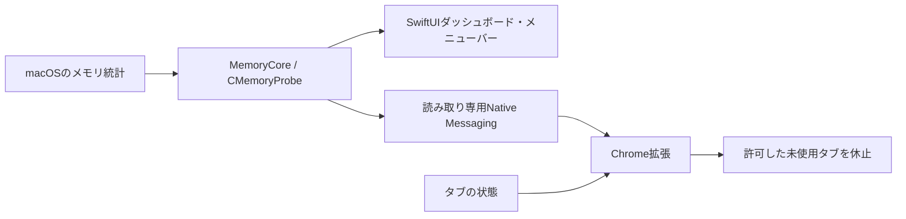

# 構成と測定仕様

[READMEへ戻る](../README.md)

Memoriqは、Mac全体の観測とChromeタブの休止を分けて扱います。

## 役割

| 部分 | 実装 | 役割 |
|:--|:--|:--|
| Macアプリ | Swift / SwiftUI / AppKit | メモリ状況を30秒ごとに更新し、ダッシュボードとメニューバーへ表示します。ユーザーが選んだアプリの通常終了も扱います。 |
| 測定コア | Swift / C / libproc | システム統計とプロセスの`phys_footprint`を読み、アプリごとに集計します。 |
| Chrome拡張 | Manifest V3 / JavaScript | 許可ホストと未使用時間をもとに候補を表示し、`chrome.tabs.discard()`で休止します。 |
| ローカル連携 | Native Messaging | 拡張から明示的に要求された時だけ、Macの計測結果を返します。 |

拡張のバックグラウンド処理はManifest V3のサービスワーカーです。ネイティブアプリのウィンドウを開いていなくても、Chromeは登録された実行ファイルを起動して計測できます。

公開表示名とアプリバンドル名はMemoriqです。Swiftの実行ファイル名`MemoryHarbor`、Bundle IDとNative Messagingホスト名`jp.local.memoryharbor`は内部識別子として維持しています。

## タブ休止の流れ

1. 保存された設定を検証し、許可ホスト・除外ホスト・未使用時間に合うタブを抽出します。
2. アクティブ、選択中、固定、音声再生中、読込中、シークレットなどを除外します。
3. 古い順に最大3件を候補として表示します。
4. 実行時に設定とタブ状態を再取得し、URLや最終アクセスが変わった候補を見送ります。
5. 1件ずつ休止を要求し、Chromeが実際に`discarded`状態になったことを確認します。

自動休止も同じ判定を使用します。初期設定はOFFです。未保存の入力、ミュート中の通話や画面共有を網羅的に検出する仕組みはなく、閲覧用サイトの明示的な許可を前提にしています。

Chrome標準のメモリセーバーと、拡張から呼び出す破棄APIでは保護の仕組みが異なります。標準機能の内部保護をすべて引き継ぐとは限りません。

## 測定の読み方

**アプリ別使用量**は`proc_pid_rusage`が返す`phys_footprint`を集計します。実行パスの外側の`.app`を単位とし、その配下にあるヘルパープロセスも含めます。

- 圧縮分の負担を含む指標です。RSSやChromeタスクマネージャーとは定義が異なります。
- 共有領域やOS側の計上方法があるため、合計はMac全体の使用量とは一致しません。
- アプリの外で動くCLIや仮想マシンは、一部がアプリ別の集計に含まれません。
- 権限やプロセスの終了タイミングで取得できなかった分は、読み取れないプロセス数として表示します。

**メモリ圧迫**はmacOSの通知レベルを使用します。取得不能・未知の値は「取得不可」とし、正常とみなしません。**スワップ**はシステムの使用量で、タブを休止しても直後に減るとは限りません。

休止前後のアプリ全体の差分には、他のタブやバックグラウンド処理の変動も含まれます。「このタブだけで何MB削減できた」という推計や、一定の削減率の保証は行いません。

## 他のElectronアプリ

他社製Electronアプリの内部ヒープや画面を、外部から一律に安全に解放する共通機能はありません。Memoriqの対応範囲は、アプリ別使用量の確認とユーザーによる通常終了です。

通常終了を要求すると、そのアプリの通知・通話・処理も停止します。終了要求の受理と終了完了は別であり、保存確認が表示された場合はアプリ側で対応します。強制終了は使用しません。

## 公式資料

- [Chrome Tabs API](https://developer.chrome.com/docs/extensions/reference/api/tabs#method-discard)
- [Chromeのメモリセーバー](https://support.google.com/chrome/answer/12929150?hl=ja)
- [Native Messaging](https://developer.chrome.com/docs/extensions/develop/concepts/native-messaging)
- [ElectronのChrome拡張互換範囲](https://www.electronjs.org/docs/latest/api/extensions)
- [Apple アクティビティモニタのメモリ情報](https://support.apple.com/ja-jp/guide/activity-monitor/actmntr1004/mac)
